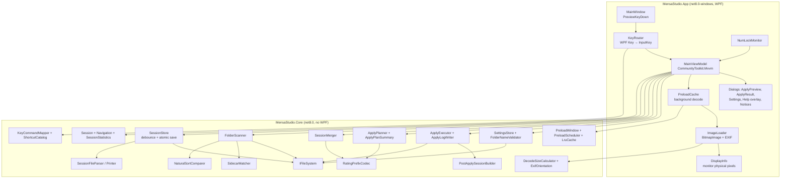

# Design Document: MensaStudio Photo Sorter

## Overview

MensaStudio is a keyboard-driven WPF desktop application for staging and applying sort decisions on large photo folders. The design separates the application into a UI-free logic library (`MensaStudio.Core`), a thin WPF shell (`MensaStudio.App`), and a test project (`MensaStudio.Core.Tests`). Every decision rule in the requirements (ordering, sidecar matching, rating prefixes, session file format, merge, apply planning, post-apply rewrite, preload windowing, key mapping) lives in Core as pure or I/O-abstracted code, so it can be verified with property-based tests (FsCheck) and temp-directory integration tests without WPF.

Key design decisions:

| Decision | Rationale |
|---|---|
| Pure planners (ApplyPlanner, SessionMerger, PostApplySessionBuilder, PreloadWindow, KeyCommandMapper) separated from executors | Lets the risky file-system logic be property-tested exhaustively; executors stay small. |
| `IFileSystem` abstraction in Core | SessionStore and ApplyExecutor can be tested against a real temp directory and against fault-injecting fakes (locked file, access denied). |
| `System.TimeProvider` (built into .NET 8) for debounce timing | Deterministic tests with `FakeTimeProvider`; no custom scheduler interface needed. |
| Conflict detection treats every snapshot file as taken, even if it will move | No target can ever equal any pre-existing path, so execution order cannot cause collisions or overwrites (Req 13.7, 13.8, 15.10). |
| Help overlay and key routing generated from one `ShortcutCatalog` | Guarantees the Help_Overlay lists exactly the handled keys (Req 18.3). |
| Natural sort as lexicographic order over "tokens" (number tokens < character tokens) with ordinal tie-break | Provably a total order; numeric runs of any length compared by digit-string length then digits, no integer overflow (Req 2.5–2.7). |
| Single-file self-contained publish with native library self-extraction | WPF native libraries cannot load from the bundle, so `IncludeNativeLibrariesForSelfExtract` is required for one exe (Req 20.2). |

### Research Findings

- **Folder picker**: .NET 8 added `Microsoft.Win32.OpenFolderDialog` to WPF, so no WinForms or COM interop is needed for Ctrl+O ([What's new in WPF for .NET 8](https://learn.microsoft.com/dotnet/desktop/wpf/whats-new/net80)).
- **Decode size**: `BitmapImage.DecodePixelWidth` (set alone) scales during decode and preserves aspect ratio; with `BitmapCacheOption.OnLoad` and `Freeze()` the bitmap can be created on a background thread and handed to the UI thread. `BitmapImage` does not apply EXIF orientation itself, so decode sizes refer to stored pixel dimensions.
- **EXIF orientation**: For JPEG, WIC exposes tag 274 via `BitmapMetadata.GetQuery("/app1/ifd/{ushort=274}")`. PNG files rarely carry EXIF that WIC exposes; when the query yields nothing, Req 4.4 applies (no transform). `TransformedBitmap` supports orthogonal transforms (90° rotations and ±1 scales), which covers all 8 orientations.
- **Single-file WPF**: For WPF, native runtime components (e.g. `wpfgfx_cor3.dll`, `PresentationNative_cor3.dll`) cannot be loaded from inside the bundle; with `IncludeNativeLibrariesForSelfExtract=true` they are extracted at first launch to the .NET bundle extraction directory (default `%TEMP%\.net\<app>\<hash>`) ([Single-file deployment](https://learn.microsoft.com/dotnet/core/deploying/single-file/overview)). This is runtime-managed cache, not application data; it is noted as a known caveat against Req 20.4. Trimming is not supported for WPF and stays off.
- **Package versions** (checked on nuget.org, pinned exactly): `CommunityToolkit.Mvvm` 8.3.2 (8.4.x targets newer Roslyn features; 8.3.2 is fully compatible with the .NET 8 SDK), `xunit` 2.9.3, `xunit.runner.visualstudio` 2.8.2, `Microsoft.NET.Test.Sdk` 17.14.1, `FsCheck.Xunit` 3.6.0 (depends on xunit 2.x `xunit.extensibility.execution` `[2.4.1, 3.0.0)` and FsCheck 3.6.0, which targets net8.0), `Microsoft.Extensions.TimeProvider.Testing` 8.10.0.

## Architecture



### Folder load sequence

```mermaid
sequenceDiagram
    participant U as User
    participant VM as MainViewModel
    participant SS as SessionStore
    participant FS as FolderScanner
    participant P as SessionFileParser
    participant M as SessionMerger
    participant PC as PreloadCache

    U->>VM: Ctrl+O / Ctrl+U
    VM->>VM: pick folder (dialog) or resolve Unsure_Folder
    alt different folder and session open
        VM->>SS: FlushAsync()
        SS-->>VM: failure → error, abort load (Req 1.9)
    end
    VM->>FS: ScanAsync(folder) (background)
    FS-->>VM: ScanResult or read error (Req 1.7)
    alt no photos
        VM-->>U: "no supported photos" notice, keep old session (Req 1.6)
    end
    VM->>P: Parse(session file text) if present
    VM->>M: Merge(scan, parse result)
    M-->>VM: Session, dropped count, changed flag
    VM->>SS: Attach(new session); MarkDirty if changed (Req 12.8)
    VM->>PC: Reset(photo list); OnPositionChanged(current)
```

### Apply sequence

```mermaid
sequenceDiagram
    participant U as User
    participant VM as MainViewModel
    participant AP as ApplyPlanner
    participant AE as ApplyExecutor
    participant SS as SessionStore
    U->>VM: Ctrl+Enter
    VM->>VM: take snapshot of file names (background)
    VM->>AP: Plan(session, snapshot)
    alt plan empty
        VM-->>U: "nothing to apply"
    else
        VM-->>U: ApplyPreview (summary)
        U->>VM: Enter (confirm)
        VM->>SS: CancelPending(); WaitForInFlight
        VM->>AE: ExecuteAsync(plan, progress)
        AE-->>VM: ApplyResult
        VM->>SS: SaveNowAsync(PostApplySessionBuilder.Build(...))
        VM->>VM: rescan + merge + set Current_Position
        VM-->>U: ApplyResult dialog
    end
```

### Threading model

- UI thread: key handling, Session mutation, view-model updates. It never performs file I/O or decoding, keeping key handling within 100 ms (Req 4.5, 5.5, 17.8).
- Background tasks: folder scans, session saves, apply snapshot + planning, apply execution, image decoding.
- `Session` guards its entry array with a private lock so `SessionStore` can take a consistent snapshot from a timer thread (Req 11.1: "every change made up to the start of the save").
- Decoded bitmaps are frozen before crossing threads.

## Components and Interfaces

All Core types are in namespace `MensaStudio.Core` (sub-namespaces omitted). Signatures are normative for implementation; private helpers are not listed.

### File system abstraction

```csharp
public interface IFileSystem
{
    bool DirectoryExists(string path);
    bool FileExists(string path);
    /// Names (not paths) of files directly inside dir. Throws IOException/UnauthorizedAccessException.
    IReadOnlyList<string> EnumerateFileNames(string directory);
    IReadOnlyList<string> EnumerateDirectoryNames(string directory);
    void CreateDirectory(string path);
    byte[] ReadAllBytes(string path);
    void WriteAllBytesDurable(string path, byte[] content);      // write + Flush(true)
    void ReplaceFile(string source, string destination);         // File.Replace, or File.Move if destination absent
    void MoveFile(string source, string destination);            // File.Move(overwrite: false)
    TextWriter OpenAppend(string path);                          // FileMode.Append, FileShare.Read, UTF-8 no BOM
}

public sealed class PhysicalFileSystem : IFileSystem { /* System.IO implementation */ }
```

### NaturalSortComparer (Req 2.4–2.7)

```csharp
public sealed class NaturalSortComparer : IComparer<string>
{
    public static NaturalSortComparer Instance { get; }
    /// Natural comparison only (may return 0 for distinct strings, e.g. "IMG_7" vs "IMG_007").
    public static int CompareNatural(string x, string y);
    /// CompareNatural, then string.CompareOrdinal as tie-break. Total order.
    public int Compare(string? x, string? y);
}
```

Algorithm: each name is read as a sequence of tokens. A maximal run of ASCII digits `0`–`9` is a Number token; every other character is a Char token holding `char.ToUpperInvariant(c)`. Tokens compare as: Number < Char; two Numbers compare by (length of digit string without leading zeros, then ordinal comparison of that digit string), so runs of any length compare correctly without parsing to an integer; two Chars compare by code unit. Sequences compare lexicographically, a proper prefix comes first. Because this is lexicographic order over a totally preordered alphabet, it is a total preorder; the ordinal tie-break turns it into a total order consistent with Req 2.7.

### FolderScanner and SidecarMatcher (Req 2, 3)

```csharp
public static class FileKinds
{
    public static readonly IReadOnlySet<string> PhotoExtensions;   // .jpg .jpeg .png, OrdinalIgnoreCase
    public static readonly IReadOnlySet<string> RawExtensions;     // .cr2 .cr3 .nef .arw .raf .orf .rw2 .dng .raw .pef .srw
    public const string SessionFileName = "MensaStudio.session.txt";
    public const string SessionTempFileName = "MensaStudio.session.txt.tmp";
    public const string ApplyLogFileName = "MensaStudio.apply.log.txt";
    public const string SettingsTempSuffix = ".tmp";
    public static bool IsPhoto(string fileName);
    public static bool IsRaw(string fileName);
    public static bool IsAppFile(string fileName);                 // session, temp, log
}

public sealed record ScannedPhoto(string FileName, IReadOnlyList<string> RawSidecars);
public sealed record ScanResult(string SourceFolder, IReadOnlyList<ScannedPhoto> Photos, bool HasSessionFile);

public static class SidecarMatcher
{
    /// Pure. photoNames/rawNames are names directly in the folder; output in Natural_Sort_Order of photos.
    public static IReadOnlyList<ScannedPhoto> Match(IEnumerable<string> photoNames, IEnumerable<string> rawNames);
}

public sealed class FolderScanner(IFileSystem fs)
{
    /// Throws FolderReadException(path, reason) when the folder cannot be enumerated.
    public ScanResult Scan(string sourceFolder);
}
```

```csharp
public static class UnsureFolderResolver
{
    public const string UnsureFolderName = "Unsure";
    /// Full path of the direct subfolder named "Unsure" (OrdinalIgnoreCase, Req 16.7), or null if absent.
    public static string? Resolve(IFileSystem fs, string sourceFolder);
}
```

Scan: `EnumerateFileNames` (files only, so subfolders and their contents are excluded by construction, Req 2.2), drop `IsAppFile` names (Req 2.3), split into photos (`IsPhoto`, final extension only) and raws (`IsRaw`), then `SidecarMatcher.Match`.

Match: sort photos with `NaturalSortComparer`. Build a dictionary `Base_Name → photo` (OrdinalIgnoreCase) in two passes: first `.png` photos, then `.jpg`/`.jpeg` photos, each pass in Natural_Sort_Order, inserting only when the key is absent within that pass; jpg entries override png entries (Req 3.2, 3.4). For each raw (sorted naturally), look up `Path.GetFileNameWithoutExtension(raw)` (removes only the final extension, Req 3.1) and append. Unmatched raws are discarded (Req 3.5). Sorting inputs first makes the result independent of enumeration order (Req 3.7).

### RatingPrefixCodec (Req 9)

```csharp
public readonly record struct RatingExtraction(int? Rating, string Unprefixed);

public static class RatingPrefixCodec
{
    /// "^[1-5]_" → (digit, rest after first underscore); otherwise (null, name).
    public static RatingExtraction Extract(string fileName);
    /// rating 1..5 → $"{rating}_{Extract(name).Unprefixed}"; null → Extract(name).Unprefixed.
    public static string Apply(string fileName, int? rating);
    /// Inserts " (n)" between the (unprefixed) base name and the final extension of an already-prefixed name.
    public static string WithConflictSuffix(string fileName, int n);
}
```

`WithConflictSuffix("3_IMG_0001.jpg", 1)` → `3_IMG_0001 (1).jpg`. The suffix is inserted immediately before `Path.GetExtension(fileName)`; existing ` (n)` text is untouched (Req 13.7).

### Session model and navigation (Req 6, 7, 8, 17)

```csharp
public sealed record PhotoEntry(string FileName, IReadOnlyList<string> RawSidecars, string? Folder, int? Rating);

public sealed class Session
{
    public Session(string sourceFolder, IReadOnlyList<PhotoEntry> photos, int currentIndex);
    public string SourceFolder { get; }
    public int Count { get; }
    public int CurrentIndex { get; }                    // -1 when Count == 0
    public PhotoEntry this[int index] { get; }
    public PhotoEntry? Current { get; }
    public int AssignedCount { get; }                   // maintained incrementally
    public int RatedCount { get; }
    public int UnassignedCount => Count - AssignedCount;
    public long Version { get; }                        // incremented on every change
    public event EventHandler<SessionChange>? Changed;

    public bool SetFolder(string folder);               // current photo; returns true if changed
    public bool ClearFolder();
    public bool SetRating(int? rating);
    public bool MoveTo(int index);
    public SessionSnapshot Snapshot();                  // thread-safe, consistent copy
}

public sealed record SessionSnapshot(string SourceFolder, IReadOnlyList<PhotoEntry> Photos, string? CurrentFileName);

public enum NextUnassignedOutcome { Moved, AllAssigned, OnlyCurrentUnassigned }
public static class Navigation
{
    public static int Next(int index, int count);               // clamps at last
    public static int Previous(int index, int count);           // clamps at first
    public static int First(int count);
    public static int Last(int count);
    public static (NextUnassignedOutcome Outcome, int Index) NextUnassigned(IReadOnlyList<PhotoEntry> photos, int current);
}

public static class SessionStatistics
{
    public static (int Assigned, int Unassigned, int Rated) Compute(IReadOnlyList<PhotoEntry> photos);
}

public static class StatusFormatter
{
    public static string Position(int index, int count);              // "142 / 1284", invariant culture
}

public static class OverlayFormatter
{
    public static string? FolderText(PhotoEntry e);                   // Folder verbatim or null
    public static string? Stars(int? rating);                         // "★" × rating or null
    public static string? RawBadge(IReadOnlyList<string> sidecars);   // "+CR2 +DNG" or null
}

public static class LegendFormatter
{
    public static IReadOnlyList<(int Key, string Text)> Rows(FolderMapping mapping);   // "unmapped" for empty slots
}
```

`NextUnassigned` scans `current+1 … Count-1`, then `0 … current-1` (Req 6.5); if nothing found it returns `AllAssigned` when the current photo is assigned (Req 6.6) or `OnlyCurrentUnassigned` (Req 6.8).

### Key mapping (Req 6, 7, 8, 14.6, 15.9, 18)

```csharp
public enum InputKey { NumPad0, NumPad1, /*…*/ NumPad9, D0, D1, /*…*/ D9, Left, Right, Home, End, N, F1, Escape, Enter, O, U, OemComma, Other }
[Flags] public enum Modifiers { None = 0, Ctrl = 1, Alt = 2, Shift = 4 }
public enum UiMode { Normal, HelpVisible, ApplyPreview, Applying, Busy }

public abstract record Command
{
    public sealed record Navigate(NavigationKind Kind) : Command;     // Next, Previous, First, Last, NextUnassigned
    public sealed record AssignSlot(int Slot) : Command;              // 1..9
    public sealed record ClearFolder : Command;
    public sealed record Rate(int? Rating) : Command;                 // null = clear
    public sealed record OpenFolder : Command;
    public sealed record OpenUnsure : Command;
    public sealed record OpenSettings : Command;
    public sealed record StartApply : Command;
    public sealed record ToggleHelp : Command;
    public sealed record HideHelp : Command;
    public sealed record ConfirmPreview : Command;
    public sealed record CancelPreview : Command;
    public sealed record None : Command;                              // ignored key
}

public static class KeyCommandMapper
{
    public static Command Map(InputKey key, Modifiers mods, bool numLockOn, UiMode mode);
}

public sealed record ShortcutInfo(string KeyText, string Description, InputKey Key, Modifiers Modifiers);
public static class ShortcutCatalog
{
    public static IReadOnlyList<ShortcutInfo> All { get; }             // single source for Help_Overlay
}
```

WPF translation (App `KeyRouter`): `var k = e.Key == Key.System ? e.SystemKey : e.Key;` then `Key.NumPad0–9 → NumPad0–9`, `Key.D0–D9 → D0–D9`, arrows/Home/End/N/F1/Escape/Enter/O/U/OemComma, all others `Other`. With NumLock off Windows reports numpad 7 as `Key.Home`, numpad 1 as `Key.End`, numpad 4/6 as Left/Right, so Req 6.3/6.4 need no special case and Req 7.11 holds because no `NumPad*` key arrives. Every key-down (including `IsRepeat`) is mapped (Req 6.1/6.2). Handled keys set `e.Handled = true`.

| Mode | Key | Modifiers | Command |
|---|---|---|---|
| Normal | Right / Left | any except Alt | Navigate Next / Previous |
| Normal | Home / End | any except Alt | Navigate First / Last |
| Normal | N | none | Navigate NextUnassigned |
| Normal | NumPad1–9 (NumLock on) | none or Shift/Ctrl, not Alt | AssignSlot(1–9) |
| Normal | NumPad0 (NumLock on) | none or Shift/Ctrl, not Alt | ClearFolder |
| Normal | D1–D5 | none | Rate(1–5) |
| Normal | D0 | none | Rate(null) |
| Normal | D6–D9, or D0–D9 with Ctrl/Alt/Shift | — | None (Req 8.5, 8.6) |
| Normal | Ctrl+O / Ctrl+U | Ctrl | OpenFolder / OpenUnsure |
| Normal | Ctrl+Enter | Ctrl | StartApply |
| Normal | Ctrl+, (OemComma) | Ctrl | OpenSettings (Req 19.12) |
| Normal | F1 | none | ToggleHelp |
| HelpVisible | F1 | none | ToggleHelp |
| HelpVisible | Escape | none | HideHelp |
| HelpVisible | anything else | — | None (Req 18.6) |
| ApplyPreview | Enter | none | ConfirmPreview |
| ApplyPreview | Escape | none | CancelPreview |
| ApplyPreview | anything else | — | None (Req 14.6) |
| Applying | anything | — | None (Req 1.10, 15.9) |
| Busy (folder scan/load in progress) | Ctrl+, (OemComma) | Ctrl | OpenSettings (Req 19.12) |
| Busy (folder scan/load in progress) | anything except F1 and Ctrl+, | — | None |

Alt+NumPad is left to Windows alt-code entry. Ctrl+, opens the Settings_Dialog per Req 19.12 and is listed in the Help_Overlay. It maps to `OpenSettings` in `Normal` and `Busy` mode (a folder load is neither a dialog nor the Apply_Executor, and a mapping change leaves session assignments unchanged per Req 19.5): `Applying` (Apply_Executor running) and `ApplyPreview` (preview dialog open) map it to `None`, and while the Settings_Dialog or any other modal dialog is open the main window receives no key input. OpenSettings does not need an open session. Session-dependent commands with no open session or zero photos are dropped by the view model (Req 6.9, 7.12, 8.7).

### SessionFileParser / SessionFilePrinter (Req 10)

```csharp
public sealed record SessionRecord(string FileName, string? Folder, int? Rating);
public sealed record SessionRecordSet(IReadOnlyList<SessionRecord> Entries, string? CurrentFileName);

public enum SkipReason { WrongFieldCount, EmptyFileName, InvalidRating, DuplicateFileName }
public sealed record SkippedLine(int LineNumber, SkipReason Reason);
public sealed record SessionParseResult(SessionRecordSet Records, IReadOnlyList<SkippedLine> Skipped);

public static class SessionFilePrinter
{
    public static string Print(SessionRecordSet records);         // text with CRLF line endings
    public static byte[] PrintBytes(SessionRecordSet records);    // UTF-8, no BOM
}

public static class SessionFileParser
{
    public static SessionParseResult Parse(string text);
    /// Decodes UTF-8 (strict, optional BOM). Throws SessionFileReadException on invalid UTF-8.
    public static SessionParseResult Parse(byte[] content);
}
```

See the Session_File format under Data Models for the exact grammar.

### SessionStore (Req 11, 1.5, 1.9, 12.8)

```csharp
public sealed class SessionStore : IAsyncDisposable
{
    public SessionStore(IFileSystem fs, TimeProvider time);
    public static readonly TimeSpan Debounce = TimeSpan.FromSeconds(1);
    public static readonly TimeSpan MaxDelay = TimeSpan.FromSeconds(5);

    public void Attach(Session session);              // detaches previous; subscribes to Changed
    public void MarkDirty();                          // called on change and after merge
    public bool IsDirty { get; }
    public bool LastSaveFailed { get; }
    public event EventHandler<SaveStatus>? SaveStatusChanged;   // Saved / Failed(exception)

    /// Cancels the timer, awaits an in-flight save, then saves if dirty. Returns failure instead of throwing.
    public Task<SaveOutcome> FlushAsync();
    /// Cancels pending debounced work and writes the given records immediately (post-apply rewrite).
    public Task<SaveOutcome> SaveNowAsync(string sourceFolder, SessionRecordSet records);
    /// Completes when no save is scheduled or running (used by tests and before Apply).
    public Task WhenIdleAsync();
}

public sealed record SaveOutcome(bool Success, string Path, Exception? Error);
```

Scheduling: on `MarkDirty`, if `firstDirtyAt` is null set it to `now`; (re)arm a one-shot `ITimer` to fire at `min(now + 1 s, firstDirtyAt + 5 s)`. When it fires, a save runs on the thread pool: take `session.Snapshot()`, clear `firstDirtyAt` and the dirty flag (recording `Version`), print, `WriteAllBytesDurable(temp)`, `ReplaceFile(temp, sessionFile)`. Saves are serialized with a `SemaphoreSlim(1)`. A change arriving during a save sets dirty again and arms a new timer. On failure: restore dirty, raise `Failed`, do not re-arm (the next change re-arms, Req 11.5); a later success raises `Saved` (Req 11.6).

### SessionMerger (Req 9.7, 9.9, 11.7–11.9, 12)

```csharp
public sealed record MergeResult(Session Session, int DroppedCount, bool Changed);

public static class SessionMerger
{
    /// parse == null means no Session_File (or unreadable, Req 11.11): every photo seeded from its prefix.
    public static MergeResult Merge(ScanResult scan, SessionParseResult? parse);
}
```

Algorithm: build `Dictionary<string, SessionRecord>` (OrdinalIgnoreCase) from parsed entries, keeping the first per name (Req 12.7). For each scanned photo in scan order (already natural order, Req 12.4): matching record → keep its Folder and Rating verbatim (Req 12.6, 9.9); otherwise Folder = null, Rating = `RatingPrefixCodec.Extract(name).Rating` (Req 9.7, 12.1), and count as added. Unmatched records are dropped (Req 12.2). `DroppedCount = unmatched records + skipped lines with reason DuplicateFileName` (Req 12.3). Current index = the photo whose name equals `CurrentFileName` (OrdinalIgnoreCase), else 0 (Req 11.8, 11.9). `Changed = added > 0 || DroppedCount > 0`.

### Preload logic (Req 5)

```csharp
public static class PreloadWindow
{
    /// Positions in decode order: p, p+1, p+2, p+3, p-1, p-2, filtered to [0, n-1]. Empty when n == 0.
    public static IReadOnlyList<int> Compute(int p, int n);
}

public sealed class LruCache<TKey, TValue> where TKey : notnull
{
    public LruCache(int capacity, IEqualityComparer<TKey>? comparer = null);
    public int Capacity { get; }
    public int Count { get; }
    public bool TryGet(TKey key, out TValue value);   // marks MRU
    public bool Touch(TKey key);                      // marks MRU
    public void Add(TKey key, TValue value);          // insert/replace as MRU; evicts LRU when full
    public bool Contains(TKey key);                   // does not touch
    public void Clear();
}

public sealed record PreloadPlan(IReadOnlyList<int> NewQueue, IReadOnlyList<int> ToTouch, IReadOnlyList<int> ToCancel);

public static class PreloadScheduler
{
    /// Pure: given the new window and the current state, decide what to enqueue (in order), touch and cancel.
    public static PreloadPlan Plan(IReadOnlyList<int> window,
                                   IReadOnlySet<int> held, IReadOnlySet<int> inFlight,
                                   IReadOnlySet<int> queued, IReadOnlySet<int> failed);
}

public static class DecodeSizeCalculator
{
    /// Returns the stored-orientation decode size: largest size ≤ original with the same aspect ratio such that
    /// both stored and oriented dimensions fit within the screen bounds (Req 4.2).
    public static (int Width, int Height) Compute(int width, int height, int orientation, int screenWidth, int screenHeight);
}

public static class ExifOrientation
{
    /// Maps tag value 1..8 to (rotationDegrees, flipHorizontal); other values → (0, false) (Req 4.3, 4.4).
    public static (int Rotation, bool FlipX) ToTransform(int? tagValue);
    public static bool SwapsDimensions(int? tagValue);   // 5..8
}
```

`PreloadScheduler.Plan`: `NewQueue` replaces the pending queue and contains, in window order, every window position that is not held, in flight or failed; `ToTouch` = window positions that are held; `ToCancel` = previously queued positions not in the window. In-flight decodes are never cancelled (Req 5.4 covers only not-started requests).

`DecodeSizeCalculator`: `scale = min(1, sw/w, sh/h, sw/ow, sh/oh)` where `(ow, oh)` are oriented dimensions; result is `(max(1, round(w·scale)), max(1, round(h·scale)))`, with scale = 1 returning the original dimensions exactly.

App `PreloadCache` (WPF) holds `LruCache<string, BitmapSource>(15, OrdinalIgnoreCase)` keyed by full path, a pending queue, an in-flight set, a `failed` dictionary (path → reason) and a `generation` integer. `Reset(photos)` increments generation, cancels the shared `CancellationTokenSource`, clears everything (Req 5.9). `OnPositionChanged(p)` applies a `PreloadPlan` and lets two worker tasks pull from the queue in order (the current photo is always first in the queue, so it starts first, Req 5.2). Completion is marshalled to the UI thread: results from an older generation are dropped; successes are added to the cache; failures are recorded in `failed` (Req 5.8); the viewer is updated only if the completed path equals the current photo path (Req 4.7).

### ImageLoader (App, Req 4)

```csharp
public sealed class ImageLoader
{
    public ImageLoader(IDisplayInfo display);
    /// Background-thread safe. Returns a frozen BitmapSource or throws ImageDecodeException(fileName, reason).
    public BitmapSource Decode(string path, CancellationToken ct);
}
public interface IDisplayInfo { (int Width, int Height) GetPhysicalPixelSize(); }   // captured on UI thread
```

Decode: open `FileStream(FileShare.ReadWrite | FileShare.Delete)`, copy into a `MemoryStream`; `BitmapFrame.Create(ms, BitmapCreateOptions.DelayCreation, BitmapCacheOption.None)` to read `PixelWidth/PixelHeight` and `Metadata` (`/app1/ifd/{ushort=274}` for JPEG, query errors treated as no tag); compute decode size with `DecodeSizeCalculator`; create `BitmapImage` with `StreamSource = ms` (rewound), `DecodePixelWidth` set only when scaling, `CacheOption = OnLoad`; wrap in `TransformedBitmap` with `RotateTransform`/`ScaleTransform(-1, 1)` from `ExifOrientation`; `Freeze()`. Any `IOException`, `UnauthorizedAccessException`, `NotSupportedException`, `FileFormatException`, `ArgumentException` becomes `ImageDecodeException` (Req 4.8). `DisplayInfo` uses `MonitorFromWindow` + `GetMonitorInfo` (`rcMonitor`) for the main window's monitor; the app manifest declares PerMonitorV2 DPI awareness so these are physical pixels.

The Viewer uses an `Image` with `Stretch="Uniform"`, `StretchDirection="Both"`, centered, `RenderOptions.BitmapScalingMode="HighQuality"` (Req 4.1). While loading it shows a spinner plus file name (Req 4.6); on failure an error placeholder with file name and "could not be decoded" plus reason (Req 4.8).

### Settings (Req 16.1, 19)

```csharp
public sealed record FolderMapping(IReadOnlyList<string?> Slots)   // exactly 9; index 0 = numpad 1; null = unmapped
{
    public static FolderMapping Default { get; }                   // Good, Okay, Bad, -, -, -, -, -, Unsure
    public string? this[int key] { get; }                          // key 1..9
}

public enum FolderNameRule { InvalidCharacter, DotOrDotDot, ReservedDeviceName, TrailingSpaceOrPeriod, TooLong, Duplicate }

public static class FolderNameValidator
{
    public const int MaxLength = 64;
    public static IReadOnlyList<FolderNameRule> Validate(string name);   // single name, empty → no violations
    /// Per-slot violations including case-insensitive duplicates among non-empty names.
    public static IReadOnlyList<IReadOnlyList<FolderNameRule>> ValidateAll(IReadOnlyList<string?> slots);
}

public sealed record SettingsLoadResult(FolderMapping Mapping, bool ResetToDefaults, string? Reason);

public sealed class SettingsStore(IFileSystem fs, string settingsPath)
{
    public static string DefaultPath { get; }        // %AppData%\MensaStudio\settings.json
    public SettingsLoadResult Load();                 // never throws
    public void Save(FolderMapping mapping);          // throws SettingsWriteException(path, reason)
    public static string Serialize(FolderMapping mapping);
    public static FolderMapping? TryDeserialize(string json, out string? reason);
}
```

Validation rules (Req 19.4): characters from `Path.GetInvalidFileNameChars()`; exactly `.` or `..`; reserved device names `CON PRN AUX NUL COM1–COM9 LPT1–LPT9 COM¹ COM² COM³ LPT¹ LPT² LPT³`, compared case-insensitively against the part before the first `.` with trailing spaces trimmed (so `nul.txt` is rejected, matching Windows behavior); ending with space or `.`; length > 64; duplicates (OrdinalIgnoreCase). Saving writes to `settings.json.tmp` and replaces, creating the directory if needed.

### ApplyPlanner and summary (Req 13, 14.2, 16.6)

```csharp
public enum ApplyKind { Move, Rename }
public sealed record FileMove(string SourcePath, string TargetPath);
public sealed record ApplyOperation(
    int SessionIndex, string PhotoFileName, ApplyKind Kind, string? DestinationFolder,
    FileMove Photo, IReadOnlyList<FileMove> Sidecars, bool HasConflictSuffix, int? Rating);
public sealed record ApplyPlan(string SourceFolder, IReadOnlyList<ApplyOperation> Operations)
{
    public IReadOnlyList<string> FoldersToEnsure { get; }   // distinct destination folder paths, OrdinalIgnoreCase, plan order
}

public sealed record FolderSnapshot(
    string SourceFolder,
    IReadOnlyList<string> SourceFileNames,
    IReadOnlyDictionary<string, IReadOnlyList<string>> SubfolderFileNames);   // key = folder name, OrdinalIgnoreCase; only existing folders

public static class ApplySnapshotReader
{
    /// Reads names directly in sourceFolder and in each existing subfolder named by a Folder_Assignment.
    /// Throws FolderReadException(path, reason) (Req 14.7).
    public static FolderSnapshot Read(IFileSystem fs, SessionSnapshot session);
}

public static class ApplyPlanner
{
    public static ApplyPlan Plan(SessionSnapshot session, FolderSnapshot snapshot);   // pure
}

public sealed record ApplyPlanSummary(
    IReadOnlyList<(string Folder, int PhotoCount)> MovesPerFolder,
    int SidecarCount, int UnassignedPhotoCount, int RenameCount, int ConflictCount);

public static class ApplyPlanSummarizer
{
    public static ApplyPlanSummary Summarize(ApplyPlan plan, SessionSnapshot session);
}
```

#### ApplyPlanner algorithm

```
taken ← HashSet<string>(OrdinalIgnoreCase)
for name in snapshot.SourceFileNames:            taken.add(Combine(src, name))
for (folder, names) in snapshot.SubfolderFileNames:
    for name in names:                            taken.add(Combine(src, folder, name))

ops ← []
for i, photo in enumerate(session.Photos):       # Session order (Req 13.12)
    if photo.Folder != null:
        kind ← Move; dir ← Combine(src, photo.Folder)                    # Req 13.1, 16.6
    else:
        kind ← Rename; dir ← src
        if RatingPrefixCodec.Apply(photo.FileName, photo.Rating) == photo.FileName (ordinal):
            continue                                                     # Req 13.5 (no op, sidecars untouched)
    baseTargets ← [Apply(photo.FileName, photo.Rating)] + [Apply(raw, photo.Rating) for raw in photo.RawSidecars]
                                                                         # Req 13.2–13.4, 13.6, 13.9
    n ← 0
    loop:
        names ← n == 0 ? baseTargets : [WithConflictSuffix(t, n) for t in baseTargets]
        paths ← [Combine(dir, x) for x in names]
        if no p in paths is in taken and paths are pairwise distinct (OrdinalIgnoreCase): break
        n ← n + 1                                                        # smallest n ≥ 1 (Req 13.7)
    taken.addAll(paths)
    ops.add(ApplyOperation(i, photo.FileName, kind, kind == Move ? photo.Folder : null,
                           FileMove(Combine(src, photo.FileName), paths[0]),
                           zip(sidecar sources, paths[1..]), n > 0, photo.Rating))
return ApplyPlan(src, ops)
```

Properties of the algorithm:
- Every snapshot file counts as taken, including the photo's own source path and files that other operations will move away (Req 13.7). Hence no target equals any path existing at plan time, and execution order cannot cause a move onto a not-yet-moved source.
- The loop terminates: each `n` produces fresh names and `taken` is finite.
- Folder names are treated opaquely; a destination folder whose name fails `FolderNameValidator` (possible only via a hand-edited Session_File) is handled by the executor as a folder creation failure (Req 15.11), so no path can escape the Source_Folder through `..` or rooted names.
- The planner performs no I/O (Req 13.10) and is deterministic (Req 13.13).

Summary: `MovesPerFolder` groups Move operations by destination folder (OrdinalIgnoreCase, display spelling of first occurrence, plan order); `SidecarCount` = Σ sidecars over all operations; `UnassignedPhotoCount` = photos in the session with `Folder == null`; `RenameCount` = Rename operations; `ConflictCount` = operations with `HasConflictSuffix`.

### ApplyExecutor (Req 15, 16.2)

```csharp
public enum OperationOutcomeKind { Succeeded, PhotoFailed, SidecarFailed, FolderCreationFailed }
public sealed record OperationOutcome(ApplyOperation Operation, OperationOutcomeKind Kind, bool PhotoMoved, string? FailureReason);
public sealed record ApplyResult(IReadOnlyList<OperationOutcome> Outcomes)
{
    public int SucceededCount { get; }
    public int FailedCount { get; }
    public IReadOnlyList<(string PhotoFileName, string Reason)> Failures { get; }
}
public readonly record struct ApplyProgress(int Completed, int Total);

public interface IApplyLogWriter : IDisposable
{
    void Write(ApplyLogEntry entry);   // one line, flushed
}
public enum ApplyLogAction { CreateFolder, Move, Rename, Skip }
public enum ApplyLogOutcome { Success, Failed, Skipped }
public sealed record ApplyLogEntry(DateTime LocalTime, ApplyLogAction Action, string SourcePath, string TargetPath,
                                   ApplyLogOutcome Outcome, string? Reason);
public static class ApplyLogFormatter { public static string Format(ApplyLogEntry e); }

public sealed class ApplyExecutor(IFileSystem fs, TimeProvider time)
{
    /// Throws ApplyLogOpenException(path, reason) before any action if the log cannot be opened (Req 15.12).
    public Task<ApplyResult> ExecuteAsync(ApplyPlan plan, IProgress<ApplyProgress>? progress, CancellationToken ct = default);
}
```

Execution:
1. Open `MensaStudio.apply.log.txt` for append; on failure throw `ApplyLogOpenException` and do nothing else (Req 15.12).
2. For each folder in `FoldersToEnsure` that does not exist: validate the name with `FolderNameValidator` (invalid → failure "invalid folder name"), else `CreateDirectory`; log `CREATE_FOLDER` with source = Source_Folder path, target = folder path (Req 15.1, 15.3). Failed folders go into a `failedFolders` map (OrdinalIgnoreCase) with reason.
3. For each operation in plan order (Req 15.2):
   - Destination folder in `failedFolders` → log `SKIP` for photo and each sidecar with the folder failure reason; outcome `FolderCreationFailed` (Req 15.11).
   - Else move the photo: if `FileExists(target)` → failure "target already exists" (Req 15.10); else `MoveFile` (catching I/O exceptions as failure reason, Req 15.4). Log `MOVE`/`RENAME`.
   - Photo failed → log `SKIP` per sidecar, outcome `PhotoFailed` (Req 15.5).
   - Photo succeeded → move each sidecar the same way; any sidecar failure → outcome `SidecarFailed` with the first reason; else `Succeeded` (Req 15.6).
   - Report progress after each operation (Req 15.9).
4. Return `ApplyResult`.

Execution runs on a background task; the UI is in `Applying` mode, and closing the main window during Apply is deferred until the executor finishes.

### PostApplySessionBuilder (Req 15.7, 15.8)

```csharp
public static class PostApplySessionBuilder
{
    public static SessionRecordSet Build(SessionSnapshot preApply, ApplyPlan plan, ApplyResult result);
}
```

For each pre-Apply photo in Session order:
- No operation → keep `(FileName, Folder, Rating)` unchanged.
- Move with `PhotoMoved == false` → keep `(FileName, Folder, Rating)` (retry next time).
- Move with `PhotoMoved == true` → omit (the photo left the Source_Folder, even if a sidecar failed).
- Rename with `PhotoMoved == true` → `(target file name, null, Rating)`.
- Rename with `PhotoMoved == false` → `(FileName, null, Rating)`.

`CurrentFileName` = post-execution name of the pre-Apply current photo if it remains, else `null` (no `#current=` line; the reload falls back to the first photo per Req 11.9). After `SessionStore.SaveNowAsync`, the view model rescans and merges (Req 15.8). If the rescan finds no photos, the app shows "No photos remain in this folder" and enters the no-session state; the Session_File stays with only the header line.

### App shell components

- `MainViewModel`: owns `Session?`, `SessionStore`, `FolderMapping`, `UiMode`, notice queue, status/overlay/legend properties (`[ObservableProperty]`). Executes `Command`s from `KeyRouter`. Status text uses `CultureInfo.InvariantCulture` integers (`$"{i+1} / {n}"`, Req 17.1).
- `OverlayFormatter` (Core): `FolderText(entry)`, `Stars(rating)` (`★` × rating), `RawBadge(sidecars)` (Req 17.4–17.6, 17.9, 17.10).
- `LegendFormatter` (Core): nine `(key, text)` rows with `"unmapped"` for empty slots (Req 17.7, 18.4).
- `NumLockMonitor`: `Keyboard.IsKeyToggled(Key.NumLock)` read on window `Loaded`, `Activated`, every key event and a 150 ms `DispatcherTimer` (Req 7.8, 7.9).
- `NoticeService`: non-modal toast, minimum display 2.5 s (Req 7.4 requires ≥ 2 s); errors that need acknowledgement use a modal message box.
- `ApplyPreviewDialog`: shows `ApplyPlanSummary`; `IsDefault` Confirm on Enter, `IsCancel` on Escape; closing via the window frame is cancel (Req 14.3, 14.4).
- `ApplyResultDialog`: success/failure counts and a list of failed photo names with reasons (Req 15.6).
- `SettingsDialog`: opened modally on `OpenSettings` (Ctrl+, per Req 19.12); nine `TextBox`es with inline validation messages from `FolderNameValidator.ValidateAll`; Save disabled-on-error behavior is replaced by explicit messages next to each invalid field (Req 19.4); write errors shown inline (Req 19.11).
- `HelpOverlay`: rendered from `ShortcutCatalog.All` plus the current `LegendFormatter` rows, rebuilt each time it is shown (Req 18.3, 18.4, 18.7).
- `MainWindow.Closing`: cancel the close, await `SessionStore.FlushAsync()`; on failure show path + reason with Retry / Exit without saving (Req 11.4, 11.10); then close for real.

## Data Models

### In-memory

| Type | Fields | Invariants |
|---|---|---|
| `PhotoEntry` | `FileName`, `RawSidecars` (natural order), `Folder?`, `Rating?` | `Rating ∈ {1..5}` or null; `Folder` non-empty or null |
| `Session` | `SourceFolder`, entries (natural order of `FileName`), `CurrentIndex` | `0 ≤ CurrentIndex < Count` or `-1` when empty; file names unique (OrdinalIgnoreCase); `AssignedCount`/`RatedCount` equal recomputed counts |
| `SessionRecordSet` | `Entries`, `CurrentFileName?` | Valid set (Req 10.7): unique non-empty names, no TAB/CR/LF in names or folders, Rating 1–5 or null, `CurrentFileName` names an entry |
| `FolderMapping` | 9 slots | Each slot null or a valid folder name; non-empty names unique (OrdinalIgnoreCase) |
| `ApplyPlan` | `SourceFolder`, operations in Session order | All target paths distinct and not in the snapshot |
| `ApplyResult` | per-operation outcome | `SucceededCount + FailedCount = Operations.Count` |

### Session_File format (`MensaStudio.session.txt`, Req 10)

Encoding UTF-8 without BOM on write, every line terminated by CR LF.

```
# MensaStudio session v1
#current=IMG_0103.jpg
IMG_0101.jpg<TAB>Good<TAB>5
IMG_0102.jpg<TAB>Unsure<TAB>
IMG_0103.jpg<TAB><TAB>3
IMG_0104.jpg<TAB><TAB>
```

Printer: line 1 header; line 2 `#current=<name>` (omitted only when `CurrentFileName` is null, i.e. after an Apply that moved the current photo away or emptied the folder); then one line per entry: `name TAB folder-or-empty TAB rating-or-empty`.

Parser (accepts optional BOM, CR LF or LF; a trailing CR is stripped from each line):

Rules are evaluated top to bottom; the first matching row decides. The TAB test comes before any `#` test, so a line containing a TAB can never be classified as a `#current=` or comment line.

| Line | Handling |
|---|---|
| empty | ignored (Req 10.5) |
| contains a TAB | entry line; continue with the entry rows below (never a `#current=` or comment line) |
| no TAB, starts with `#current=` | the first such line sets `CurrentFileName` to the text after `#current=` up to the end of the line; later such lines are ignored (Req 10.4) |
| no TAB, starts with `#` | ignored (header/comment, Req 10.5) |
| no TAB, does not start with `#` | entry line; fails the next row |
| `Split('\t')` length ≠ 3 | skipped, `WrongFieldCount` (Req 10.6) |
| empty name field | skipped, `EmptyFileName` |
| rating field not empty and not one of `1`–`5` | skipped, `InvalidRating` |
| name equal (OrdinalIgnoreCase) to an earlier kept entry | skipped, `DuplicateFileName` (Req 10.8) |
| otherwise | entry `(name, folder == "" ? null : folder, rating)` |

Design note on `#`: Windows file names may start with `#` (e.g. `#1.jpg`) or even be `#current=x.jpg`. Entry lines always contain exactly two TABs, while the header and `#current=` lines never contain a TAB (file names cannot contain TAB). Req 10.4 and 10.5 therefore restrict the `#current=` and comment rules to TAB-free lines, and the parser checks for a TAB first. The entry line `#current=x.jpg<TAB>Good<TAB>5` parses as an entry named `#current=x.jpg` and leaves `CurrentFileName` untouched, and the printed `#current=#current=x.jpg` line (no TAB) sets `CurrentFileName` to `#current=x.jpg`. This makes the round trip of Req 10.7 hold for all valid record sets.

### Apply_Log format (`MensaStudio.apply.log.txt`, Req 15.3)

UTF-8 without BOM, CR LF, appended, one line per action:

```
yyyy-MM-dd HH:mm:ss<TAB>ACTION<TAB>source<TAB>target<TAB>OUTCOME[: reason]
2025-03-14 18:02:11	CREATE_FOLDER	D:\Shoot	D:\Shoot\Good	SUCCESS
2025-03-14 18:02:11	MOVE	D:\Shoot\IMG_0101.jpg	D:\Shoot\Good\5_IMG_0101.jpg	SUCCESS
2025-03-14 18:02:11	MOVE	D:\Shoot\IMG_0102.jpg	D:\Shoot\Good\IMG_0102.jpg	FAILED: The process cannot access the file because it is being used by another process.
2025-03-14 18:02:11	SKIP	D:\Shoot\IMG_0102.CR2	D:\Shoot\Good\IMG_0102.CR2	SKIPPED: photo move failed
2025-03-14 18:02:12	RENAME	D:\Shoot\IMG_0103.jpg	D:\Shoot\3_IMG_0103.jpg	SUCCESS
```

`ACTION ∈ {CREATE_FOLDER, MOVE, RENAME, SKIP}`, `OUTCOME ∈ {SUCCESS, FAILED, SKIPPED}`. Time is local time from `TimeProvider.GetLocalNow()` formatted with `CultureInfo.InvariantCulture`. TAB, CR and LF inside reasons are replaced with spaces so each action is exactly one line.

### settings.json (`%AppData%\MensaStudio\settings.json`, Req 19)

```json
{
  "version": 1,
  "folders": ["Good", "Okay", "Bad", "", "", "", "", "", "Unsure"]
}
```

`folders[i]` is numpad key `i+1`; `""` means Unmapped_Key. Deserialization with `System.Text.Json` fails (→ defaults + notice, file left untouched, Req 19.8) when JSON is malformed, `folders` is missing or does not have exactly 9 string entries, or `FolderNameValidator.ValidateAll` reports any violation.

### Project layout

```
MensaStudio.sln
src/MensaStudio.Core/MensaStudio.Core.csproj            net8.0, Nullable enable, no package references
src/MensaStudio.App/MensaStudio.App.csproj              net8.0-windows, UseWPF, app.manifest (PerMonitorV2, asInvoker)
    Properties/PublishProfiles/win-x64.pubxml
    PackageReference CommunityToolkit.Mvvm 8.3.2
tests/MensaStudio.Core.Tests/MensaStudio.Core.Tests.csproj   net8.0
    xunit 2.9.3, xunit.runner.visualstudio 2.8.2, Microsoft.NET.Test.Sdk 17.14.1,
    FsCheck.Xunit 3.6.0, Microsoft.Extensions.TimeProvider.Testing 8.10.0
```

`win-x64.pubxml`:

```xml
<Project>
  <PropertyGroup>
    <Configuration>Release</Configuration>
    <TargetFramework>net8.0-windows</TargetFramework>
    <RuntimeIdentifier>win-x64</RuntimeIdentifier>
    <SelfContained>true</SelfContained>
    <PublishSingleFile>true</PublishSingleFile>
    <IncludeNativeLibrariesForSelfExtract>true</IncludeNativeLibrariesForSelfExtract>
    <EnableCompressionInSingleFile>true</EnableCompressionInSingleFile>
    <PublishReadyToRun>false</PublishReadyToRun>
    <PublishTrimmed>false</PublishTrimmed>
    <DebugType>embedded</DebugType>
    <PublishDir>bin\publish\win-x64\</PublishDir>
  </PropertyGroup>
</Project>
```

`DebugType=embedded` keeps the publish folder to exactly one file (Req 20.2). Publish command: `dotnet publish src/MensaStudio.App -p:PublishProfile=win-x64`.

## Correctness Properties

*A property is a characteristic or behavior that should hold true across all valid executions of a system-essentially, a formal statement about what the system should do. Properties serve as the bridge between human-readable specifications and machine-verifiable correctness guarantees.*

All properties target Core types and run under FsCheck against pure functions or the in-memory `IFileSystem` fake. Criteria classified as UI, performance or smoke checks (for example 4.1, 4.5, 5.5, 7.8, 17.8, 20.x) are covered by example, integration or manual tests in the Testing Strategy. Redundant candidates were merged during reflection: the codec criteria collapse into three properties, the merge criteria into three, the planner criteria into four, and all modal key-gating criteria into one mapper property. Req 7.6/19.5 (mapping changes never touch assignments) holds structurally because `Session` never references `FolderMapping`, so it is covered by an example test rather than a property.

### Property 1: Photo and RAW classification uses only the final extension

*For any* file name, `FileKinds.IsPhoto` returns true exactly when `Path.GetExtension(name)` equals `.jpg`, `.jpeg` or `.png` ignoring case, `IsRaw` returns true exactly when it equals one of the RAW_Extensions ignoring case, and no name is both; consequently the photo list produced by `SidecarMatcher.Match` contains no RAW name.

**Validates: Requirements 2.1, 3.6**

### Property 2: Natural sort is a deterministic total order

*For any* list of distinct file names and any permutation of it, sorting with `NaturalSortComparer` yields the identical sequence; for any two distinct names exactly one of `Compare(a, b) < 0` or `Compare(b, a) < 0` holds; for any three names the comparer is transitive; and whenever `CompareNatural(a, b) == 0`, `Compare(a, b)` has the sign of `string.CompareOrdinal(a, b)`. The scanner's photo list is sorted under this comparer.

**Validates: Requirements 2.4, 2.5, 2.7**

### Property 3: Numeric runs compare by value at any length

*For any* prefix not ending in a digit, suffix not starting with a digit, and non-negative integers `a < b` of arbitrary size (generated as `BigInteger`, rendered with optional leading zeros), the name `prefix + a + suffix` sorts before `prefix + b + suffix`.

**Validates: Requirements 2.6**

### Property 4: Sidecar matching agrees with a reference model and ignores enumeration order

*For any* set of photo names and RAW names (generated with deliberately shared base names, mixed case, `.jpg`/`.jpeg`/`.png` siblings and names like `x.jpg.cr2`), `SidecarMatcher.Match` associates every RAW with the photo chosen by a straightforward reference model (case-insensitive full Base_Name match; jpg/jpeg group preferred over png; first in Natural_Sort_Order within a group), associates each RAW with at most one photo, lists each photo's RAWs in Natural_Sort_Order, omits RAWs with no matching photo entirely, and returns the same result for every permutation of the input.

**Validates: Requirements 3.1, 3.2, 3.3, 3.4, 3.5, 3.7**

### Property 5: Decode size fits the display and preserves aspect ratio

*For any* original size `(w, h)` with 1 ≤ w, h ≤ 20000, orientation 1–8 or other, and screen size `(sw, sh)` with 1 ≤ sw, sh ≤ 10000, `DecodeSizeCalculator.Compute` returns `(dw, dh)` with `dw ≤ w`, `dh ≤ h`, `dw ≤ sw`, `dh ≤ sh`, oriented dimensions within `(sw, sh)`, `|dw/dh − w/h|` within one pixel of rounding, and `(dw, dh) == (w, h)` whenever both stored and oriented dimensions already fit.

**Validates: Requirements 4.2**

### Property 6: Preload window contents and decode order

*For any* `n ≥ 1` and `0 ≤ p < n`, `PreloadWindow.Compute(p, n)` contains exactly the positions `max(0, p−2) … min(n−1, p+3)`, each once, ordered as the subsequence of `[p, p+1, p+2, p+3, p−1, p−2]` that lies in range, with `p` first.

**Validates: Requirements 5.2, 5.6**

### Property 7: Preload plan schedules, touches and cancels correctly

*For any* window and any disjoint-or-overlapping sets of held, in-flight, queued and failed positions, `PreloadScheduler.Plan` returns a `NewQueue` equal to the window positions (in window order) that are not held, in flight or failed; a `ToTouch` equal to the window positions that are held; and a `ToCancel` equal to the queued positions outside the window. No failed position ever appears in `NewQueue`.

**Validates: Requirements 5.1, 5.4, 5.8**

### Property 8: LRU cache matches a list model

*For any* capacity (fixed at 15 for the production check) and any sequence of `Add`, `TryGet`, `Touch` and `Clear` operations over a small key space, `LruCache` behaves identically to a reference model that keeps keys in recency order and drops the least recent key on overflow: same `Count`, same membership, same evicted key, and `Count ≤ Capacity` after every operation.

**Validates: Requirements 5.3, 5.7**

### Property 9: Basic navigation moves by one and clamps at the ends

*For any* `n ≥ 1` and `0 ≤ i < n`, `Next(i, n) == min(i+1, n−1)`, `Previous(i, n) == max(i−1, 0)`, `First(n) == 0` and `Last(n) == n−1`; applying `Next` k times from `i` yields `min(i+k, n−1)`.

**Validates: Requirements 6.1, 6.2, 6.3, 6.4, 6.7**

### Property 10: Next-unassigned search is cyclic and reports the right outcome

*For any* list of photo entries with random assignments and any current index, `NextUnassigned` returns `Moved` with the index of the first unassigned photo at offsets 1 … n−1 (mod n) from the current index when one exists; otherwise it returns `AllAssigned` when the current photo is assigned and `OnlyCurrentUnassigned` when it is not, with the index unchanged in both cases.

**Validates: Requirements 6.5, 6.6, 6.8**

### Property 11: Folder commands change only the current photo's assignment

*For any* non-empty session, current index and Folder_Mapping, executing `AssignSlot(k)` for a mapped slot sets the current photo's folder to `mapping[k]` (replacing any previous value), leaves every other entry and every Rating unchanged, and moves the current index to `min(i+1, n−1)`; executing `AssignSlot(k)` for an Unmapped_Key changes nothing; executing `ClearFolder` sets the current photo's folder to none and leaves the index and all other data unchanged.

**Validates: Requirements 7.1, 7.2, 7.3, 7.4, 7.7, 7.10**

### Property 12: Rating commands change only the current photo's rating

*For any* non-empty session, current index and rating `r ∈ {null, 1..5}`, executing `Rate(r)` sets the current photo's Rating to `r`, leaves its Folder, the current index and every other entry unchanged, and executing `Rate(r)` twice gives the same session as executing it once.

**Validates: Requirements 8.1, 8.2, 8.3, 8.4**

### Property 13: Key mapping separates channels and respects modal states

*For any* `InputKey`, modifier combination, NumLock state and `UiMode`: a `NumPad*` key maps only to `AssignSlot`, `ClearFolder` or `None`, and always to `None` when NumLock is off; a `D0`–`D9` key maps only to `Rate` or `None`, to `Rate` only for `D0`–`D5` with no modifiers, independent of NumLock; in `Applying` every key maps to `None`; in `ApplyPreview` only Enter (`ConfirmPreview`) and Escape (`CancelPreview`) map to non-`None`; in `HelpVisible` only F1 (`ToggleHelp`) and Escape (`HideHelp`) map to non-`None`; Ctrl+`OemComma` (no other modifier) maps to `OpenSettings` in `Normal` and `Busy` mode and to `None` in `Applying` and `ApplyPreview`, and no other key combination in any mode maps to `OpenSettings`.

**Validates: Requirements 1.10, 7.5, 7.11, 8.5, 8.6, 14.6, 15.9, 18.6, 19.12**

### Property 14: Help catalog lists exactly the handled shortcuts

*For any* `InputKey` and modifier combination in `Normal` mode (with NumLock on and off), `KeyCommandMapper.Map` returns a non-`None` command if and only if some `ShortcutCatalog.All` entry describes that key and modifier combination, and every catalog entry maps to a non-`None` command.

**Validates: Requirements 18.3**

### Property 15: Rating prefix extraction

*For any* digit `d ∈ 1..5` and string `s`, `Extract($"{d}_{s}") == (d, s)`; and *for any* file name that does not match `^[1-5]_`, `Extract(name) == (null, name)`.

**Validates: Requirements 9.1, 9.2**

### Property 16: Rating prefix round trip

*For any* file name and rating `r ∈ 1..5`, `Extract(Apply(name, r)) == (r, Extract(name).Unprefixed)`; and *for any* file name whose unprefixed name does not start with a Rating_Prefix, `Extract(Apply(name, null)) == (null, Extract(name).Unprefixed)`.

**Validates: Requirements 9.3, 9.4, 9.5, 9.8**

### Property 17: Rating prefix application is idempotent

*For any* file name and rating `r ∈ 1..5`, `Apply(Apply(name, r), r) == Apply(name, r)`; and *for any* file name whose unprefixed name does not start with a Rating_Prefix, `Apply(Apply(name, null), null) == Apply(name, null)`.

**Validates: Requirements 9.6**

### Property 18: Session file round trip

*For any* valid Session record set (unique names, no TAB/CR/LF, names that may start with `#` or with `#current=` such as `#current=x.jpg`, ratings 1–5 or none, folders possibly none, current naming an entry), `Parse(Print(x)).Records` is equivalent to `x` with no skipped lines, and `Print(Parse(Print(x)).Records) == Print(x)`; each entry line of `Print(x)` consists of exactly three TAB-separated fields.

**Validates: Requirements 10.1, 10.4, 10.7**

### Property 19: Session file encoding and parser tolerance

*For any* valid record set, `PrintBytes(x)` starts without a UTF-8 BOM, starts with the header line and the `#current=` line, and every line ends with CR LF with no bare LF or CR; and parsing a variant of the printed text that uses LF line endings, a leading BOM and/or randomly inserted empty lines and TAB-free `#` comment lines (other than `#current=`) yields the same records and no skipped lines.

**Validates: Requirements 10.2, 10.3, 10.4, 10.5**

### Property 20: Malformed and duplicate session lines are skipped and reported

*For any* valid record set and any set of injected bad lines (wrong field count, empty name, rating outside `""`/`1`–`5`, or a case-variant duplicate of an earlier entry name) inserted at random positions, the parser returns the original entries in order, reports exactly the one-based line numbers of the injected lines with the matching `SkipReason`, and keeps the earlier entry for each duplicate.

**Validates: Requirements 10.6, 10.8**

### Property 21: Debounced saving meets the 1 s / 5 s timing bounds

*For any* sequence of change times (random gaps between 0 and 3 s) driven through `FakeTimeProvider` with an in-memory file system, every change is written by a save that starts no later than 1 s after the most recent change preceding it and no later than 5 s after the first unsaved change, no save starts while a later change is less than 1 s away unless the 5 s cap forces it, and the final Session_File content equals the printed final session snapshot.

**Validates: Requirements 11.1, 11.2**

### Property 22: Merge keeps exactly the scanned photos with correct values

*For any* scan result and any parsed Session_File (entries overlapping the scan with random case differences, extra unknown entries and duplicates), the merged session contains each scanned photo exactly once, under its scanned file name, in Natural_Sort_Order; a photo with a matching entry (first matching entry in line order, case-insensitive) carries that entry's Folder and Rating verbatim, including none; a photo without a matching entry has no Folder and the Rating extracted from its file name's prefix.

**Validates: Requirements 9.7, 9.9, 11.7, 12.1, 12.2, 12.4, 12.5, 12.6, 12.7, 16.4, 16.5**

### Property 23: Merge restores the current position or falls back to the first photo

*For any* scan result and parsed Session_File, the merged current index points to the photo whose name equals the `#current=` name case-insensitively when such a photo exists, and to index 0 otherwise (absent line or unknown name).

**Validates: Requirements 11.8, 11.9**

### Property 24: Merge reports dropped entries and changes accurately

*For any* scan result and parsed Session_File, `DroppedCount` equals the number of parsed entries matching no scanned photo plus the number of lines skipped as duplicates, and `Changed` is true exactly when `DroppedCount > 0` or at least one scanned photo had no matching entry.

**Validates: Requirements 12.3, 12.8**

### Property 25: Planned operations have the right kind, folder and target names

*For any* session and snapshot, for every photo: if it has a Folder, the plan contains a Move whose target directory is `SourceFolder\Folder`; if it has no Folder and `Apply(name, rating) != name`, a Rename within the Source_Folder; otherwise no operation. Every operation's photo target name equals `Apply(photoName, rating)` with an optional conflict suffix inserted before the extension; each sidecar target equals `Apply(sidecarName, rating)` with the same suffix in the same directory, preserving the sidecar's own base-name case and extension; and every target name starts with `"{rating}_"` when the photo has a Rating and has no Rating_Prefix otherwise.

**Validates: Requirements 13.1, 13.2, 13.3, 13.4, 13.5, 13.6, 13.9, 16.6**

### Property 26: Planned target paths are unique and never collide with existing files

*For any* session and snapshot (generated so that collisions with existing files, with files that are themselves moving, and between photos are frequent), all photo and sidecar target paths in the plan are pairwise distinct ignoring case, and none equals ignoring case any path in the snapshot.

**Validates: Requirements 13.8**

### Property 27: Conflict suffixes are minimal and assigned in Session order

*For any* session and snapshot, operations appear in increasing Session index, and for each operation with suffix `n` (0 meaning none), every smaller suffix value `m ∈ {0, 1, …, n−1}` would produce at least one photo or sidecar target path that collides, ignoring case, with the snapshot or with a target of an earlier operation.

**Validates: Requirements 13.7, 13.12**

### Property 28: Planning is deterministic

*For any* session and snapshot, `ApplyPlanner.Plan` called twice returns structurally equal plans, and calling it with the snapshot's file name lists permuted also returns an equal plan.

**Validates: Requirements 13.13**

### Property 29: Preview summary counts equal plan counts

*For any* session and plan computed from it, `ApplyPlanSummarizer.Summarize` reports for each destination folder the number of Move operations to it (case-insensitive grouping, only folders with ≥ 1 operation), a sidecar count equal to the total sidecars across operations, an unassigned count equal to the photos with no Folder, a rename count equal to the Rename operations and a conflict count equal to the operations with a suffix.

**Validates: Requirements 14.2**

### Property 30: Executor outcomes on a fault-injecting file system

*For any* plan executed against an in-memory file system with randomly injected move failures, randomly pre-created target files (created after planning) and random folder creation failures: moves are attempted in plan order with each photo before its sidecars; a failed photo move leaves the photo and all its sidecars at their source paths and none of its sidecars is attempted; no existing file is ever overwritten; every file not reported as moved is at its source path; an operation is counted successful exactly when the photo and all sidecars reached their targets; and `SucceededCount + FailedCount` equals the operation count.

**Validates: Requirements 15.2, 15.4, 15.5, 15.6, 15.10, 15.11**

### Property 31: One log line per file system action

*For any* plan and injected-failure configuration as in Property 30, the Apply_Log gains exactly one line per folder creation attempted, per photo or sidecar move or rename attempted, and per skipped photo or sidecar; existing log lines are preserved; and every new line has five TAB-separated fields where field 2 is one of `CREATE_FOLDER`, `MOVE`, `RENAME`, `SKIP` and field 5 starts with `SUCCESS`, `FAILED` or `SKIPPED`.

**Validates: Requirements 15.3**

### Property 32: Post-apply session contains exactly the remaining photos

*For any* pre-Apply session, plan and random per-operation outcome, `PostApplySessionBuilder.Build` returns one entry per photo still in the Source_Folder: unchanged entries for photos without an operation; original name, Folder and Rating for photos whose own move or rename failed; the target name with no Folder and the original Rating for successfully renamed photos; and no entry for successfully moved photos. `CurrentFileName` is the post-execution name of the pre-Apply current photo when it remains, and null otherwise.

**Validates: Requirements 15.7**

### Property 33: Status position text has no digit grouping

*For any* `n ≥ 1` and `0 ≤ i < n` (including values above 999 and under cultures that group digits), the status position text equals `(i+1).ToString(InvariantCulture) + " / " + n.ToString(InvariantCulture)` and contains no group separator.

**Validates: Requirements 17.1**

### Property 34: Session counters stay consistent

*For any* initial session and any sequence of `SetFolder`, `ClearFolder`, `SetRating` and `MoveTo` operations, `AssignedCount` and `RatedCount` equal the counts recomputed by `SessionStatistics.Compute`, and `AssignedCount + UnassignedCount == Count`.

**Validates: Requirements 17.3**

### Property 35: Overlay formatting

*For any* photo entry, the overlay folder text equals the stored Folder exactly (including names absent from the mapping) and is omitted when there is none; the star text consists of exactly `Rating` star symbols and is omitted when there is no Rating; and the RAW badge consists of the distinct sidecar extensions without the dot, in upper case, each prefixed with `+`, sorted ordinally and joined by single spaces, and is omitted when there are no sidecars.

**Validates: Requirements 17.4, 17.5, 17.6, 17.9, 17.10**

### Property 36: Legend lists nine keys with names or "unmapped"

*For any* Folder_Mapping, `LegendFormatter` returns nine rows for keys 1 to 9 in ascending order, each showing the slot's folder name, or `unmapped` for an Unmapped_Key.

**Validates: Requirements 17.7, 18.4**

### Property 37: Folder name validation detects each rule

*For any* generated valid folder name (1–64 characters from allowed characters, not ending in space or period, not reserved), `Validate` returns no violation; and *for any* name derived from a valid name by inserting an invalid character, appending a space or period, extending beyond 64 characters, or replacing it with a reserved device name in any letter case (optionally with an extension), `Validate` reports the corresponding rule. *For any* slot list containing two non-empty names equal ignoring case, `ValidateAll` reports `Duplicate` for both slots.

**Validates: Requirements 19.4**

### Property 38: Settings round trip

*For any* valid Folder_Mapping, `TryDeserialize(Serialize(m))` returns a mapping in which every key 1–9 has the identical folder name (ordinal, case-sensitive) or is unmapped in both.

**Validates: Requirements 19.9**

## Error Handling

| Situation | Detection | Response | Req |
|---|---|---|---|
| Folder cannot be read on load | `FolderReadException` from scanner | Modal error with path and reason; previous session untouched | 1.7 |
| Folder has no photos | `ScanResult.Photos.Count == 0` | Notice; no Session_File created; previous session untouched | 1.6 |
| Saving before folder switch fails | `FlushAsync` returns failure | Error "session could not be saved"; abort load | 1.9 |
| Ctrl+U without Unsure_Folder | Resolver returns null | Notice; nothing changes | 1.4 |
| Image decode failure | `ImageDecodeException` | Error placeholder with file name; path recorded in `failed`, not retried until next load; commands still work | 4.8, 4.9, 5.8 |
| Stale decode result | generation / path mismatch | Discarded silently | 4.7, 5.9 |
| Unmapped numpad key | Mapping slot null | Toast naming the key, ≥ 2 s | 7.4 |
| N with all assigned | `AllAssigned` | Toast "All photos are assigned" | 6.6 |
| Session_File unreadable (I/O error or invalid UTF-8) | `SessionFileReadException` | Error with reason; load from scan only | 11.11 |
| Session_File lines skipped | `Skipped.Count > 0` | Notice with count and line numbers | 11.12 |
| Entries dropped in merge | `DroppedCount > 0` | Notice with count; save within 1 s | 12.3, 12.8 |
| Background save fails | `SaveOutcome.Success == false` | Status bar error indicator; retry on next change; cleared on success | 11.5, 11.6 |
| Save on close fails | `FlushAsync` failure in `Closing` | Dialog with path and reason: Retry / Exit without saving | 11.10 |
| Snapshot read fails for Apply | `FolderReadException` | Error with folder path and reason; no preview | 14.7 |
| Nothing to apply | `plan.Operations.Count == 0` | Notice "Nothing to apply" | 14.5 |
| Apply_Log cannot be opened | `ApplyLogOpenException` | Error with log path and reason; no file action; session unchanged | 15.12 |
| Destination folder creation fails or name invalid | exception / validator | Logged; dependent operations failed without attempting moves | 15.11 |
| Target exists at execution time | `FileExists(target)` before move; `File.Move(overwrite:false)` as second guard | Operation failed "target already exists"; nothing overwritten | 15.10 |
| Move/rename fails (locked, denied, missing) | exception from `MoveFile` | Logged with reason; sidecars skipped if photo failed; continue | 15.4, 15.5 |
| Post-apply session rewrite fails | `SaveNowAsync` failure | Status bar error indicator; in-memory session replaced by rescan+merge result and marked dirty so the next change retries | 11.5 |
| Settings file corrupt or invalid | `TryDeserialize` null | Defaults + notice; file left unmodified | 19.8 |
| Settings write fails | `SettingsWriteException` | Inline error with path and reason; dialog stays open; old mapping active | 19.11 |
| Window close during Apply | `UiMode.Applying` | Close deferred until Apply completes, then normal flush | 15.9 |

General rules: Core throws typed exceptions (`FolderReadException`, `SessionFileReadException`, `ApplyLogOpenException`, `SettingsWriteException`, `ImageDecodeException`) that carry the path and a human-readable reason (the inner exception message). The App catches them at command boundaries and never lets a background exception crash the process; an `AppDomain`/`Dispatcher` unhandled-exception handler flushes the session and shows the error.

## Testing Strategy

### Dual approach

- **Property-based tests (FsCheck.Xunit 3.6.0)** cover all 38 properties above. They exercise the pure Core components and the in-memory file-system fake.
- **Example-based unit tests (xUnit 2.9.3)** cover concrete examples from the requirements, specific edge cases and error paths that do not vary meaningfully with input.
- **Integration tests** run against real temp directories (`Path.GetTempPath()/MensaStudio.Tests/<guid>`, deleted in `Dispose`) for `PhysicalFileSystem`, `FolderScanner`, `SessionStore`, `SettingsStore` and `ApplyExecutor`.
- **Manual / smoke checks** cover WPF rendering, timing and packaging.

### Property test configuration

- Every property is implemented by exactly one `[Property(MaxTest = 100)]` test (higher for cheap ones such as the codec and comparer, e.g. `MaxTest = 500`), never fewer than 100 iterations.
- Each test carries a tag comment in the form:
  `// Feature: mensa-studio-photo-sorter, Property 26: Planned target paths are unique and never collide with existing files`
- Custom generators live in `tests/MensaStudio.Core.Tests/Generators/` and are registered via `[Property(Arbitrary = new[] { typeof(PhotoArbitraries) })]`, using `FsCheck.Fluent` (`Gen`, `Arb.From`):
  - **File names**: Windows-valid characters only (letters in mixed case, ASCII digits, `_`, `-`, ` `, `.`, `(`, `)`, `#`, `=`, non-ASCII letters such as `é`, `ß`, `ü`), no trailing space/period, biased toward rating prefixes (`3_…`, `3_3_…`, `0_…`, `6_…`), digit runs with leading zeros, and existing ` (n)` suffixes; photo extensions and RAW extensions with random letter case.
  - **Folders and snapshots**: folder names from a small pool (to force sharing and case variants, e.g. `Good`/`good`) and snapshot file lists seeded from the session's own planned target names to force collisions.
  - **Session record sets**: unique names per OrdinalIgnoreCase, optional folders and ratings, current chosen from the entries.
  - **Fault plans**: random subsets of source paths whose `MoveFile` throws, targets pre-created after planning, folder names whose creation throws.
- `InMemoryFileSystem` (test project) implements `IFileSystem` with OrdinalIgnoreCase paths, `File.Move`-like no-overwrite semantics, operation recording (for ordering assertions) and fault injection.
- Timing properties use `FakeTimeProvider` (Microsoft.Extensions.TimeProvider.Testing 8.10.0) and await the store's internal save task through a test hook (`SessionStore.WhenIdleAsync()`), so no real delays occur.

### Example and edge-case unit tests

- `RatingPrefixCodec`: every example in Req 9.1–9.4 (`3_IMG_01.JPG`, `3_3_x.jpg`, `10_x.jpg`, `0_x.jpg`, `6_x.jpg`, `3-x.jpg`, `3x.jpg`, `_3_x.jpg`, `IMG_3_x.jpg`, `2_x.jpg` → `4_x.jpg`/`x.jpg`); `WithConflictSuffix` examples from Req 13.7.
- `NaturalSortComparer`: `IMG_2` < `IMG_10`, `IMG_9` < `IMG_10`, 20-digit vs 21-digit runs, `IMG_7` vs `IMG_007`, `img_1` vs `IMG_1`.
- `SidecarMatcher`: `IMG_1.jpg.cr2` does not match `IMG_1.jpg`; jpg vs png preference; two RAWs on one photo.
- `ExifOrientation`: the 8 tag mappings, plus 0, 9 and null → identity (Req 4.3, 4.4).
- `SessionFileParser`: header-only file, missing `#current=`, BOM + LF file, a photo named `#1.jpg`, an entry line for a photo named `#current=x.jpg` (parsed as an entry, `CurrentFileName` unchanged) before and after the real `#current=` line, two TAB-free `#current=` lines (the first wins), invalid UTF-8 → `SessionFileReadException`.
- `KeyCommandMapper`: one example per row of the key mapping table, including numpad 7/1 with NumLock off arriving as Home/End, and Ctrl+, → `OpenSettings` in `Normal`/`Busy` and → `None` in `Applying`/`ApplyPreview` (Req 19.12).
- `FolderMapping.Default` = Good/Okay/Bad/–/–/–/–/–/Unsure (Req 16.1, 19.1); `SettingsStore.Load` with absent file (defaults, no reset notice) and corrupt file (defaults, reset notice, file bytes unchanged).
- Mapping change leaves session assignments unchanged, including folder names no longer mapped (Req 7.6, 19.5).
- `ApplyPlanner` performance smoke: 10,000 photos with sidecars and a 10,000-file snapshot plans in well under 2 s (Req 14.1).
- `Unsure` resolution: `Unsure`, `unsure`, missing folder (Req 1.3, 1.4, 16.7).

### Integration tests (temp directories)

- `FolderScanner`: subfolder named `x.jpg`, nested photos, app files and `.tmp` file excluded (Req 2.2, 2.3); unreadable folder → `FolderReadException` (Req 1.7).
- `SessionStore`: atomic save leaves previous content when the temp write fails (fault-injecting wrapper over `PhysicalFileSystem`, Req 11.3); `FlushAsync` writes pending changes and waits for an in-flight save (Req 1.5, 11.4); failure → `LastSaveFailed`, success afterwards clears it (Req 11.5, 11.6).
- Load pipeline: scan + parse + merge on a real folder with a Session_File, including the Unsure_Folder using its own Session_File (Req 1.2, 11.7, 16.3).
- `ApplyExecutor`: creates folders before moves (Req 15.1), moves photo + RAW with prefix and suffix into `Unsure` (Req 16.2), a locked file (opened with `FileShare.None`) fails and its sidecars are skipped (Req 15.4, 15.5), a target created between planning and execution is not overwritten (Req 15.10), log open failure aborts (Req 15.12), followed by post-apply rewrite and rescan (Req 15.7, 15.8).
- `SettingsStore`: save → load round trip on disk; write failure reported (Req 19.3, 19.11).

### Manual and smoke checks (App)

- Viewer fit and centering on resize, EXIF-rotated sample photos, loading indicator and error placeholder (Req 4.1, 4.3, 4.6, 4.8).
- Key responsiveness while decoding and instant display of cached neighbors on a folder of several thousand 24 MP JPEGs (Req 4.5, 5.5, 17.8).
- NumLock indicator updates when toggling NumLock and on window re-activation (Req 7.8, 7.9).
- Help overlay toggle, Escape, key suppression (Req 18.1, 18.2, 18.5); Apply preview and result dialogs (Req 14.3, 14.4, 15.6, 15.9); Settings dialog validation and cancel (Req 19.2, 19.10).
- Packaging: `dotnet publish src/MensaStudio.App -p:PublishProfile=win-x64` produces exactly one `.exe` in the publish folder; copy alone to a Windows 10/11 x64 VM without .NET, launch as a standard user, confirm the main window appears and that only `%AppData%\MensaStudio\` and the Source_Folder are written (Req 20.1–20.4). The runtime's native-library extraction cache under `%TEMP%\.net\` is expected and documented.

### Commands

- Build: `dotnet build MensaStudio.sln -c Release`
- Tests: `dotnet test tests/MensaStudio.Core.Tests -c Release`
